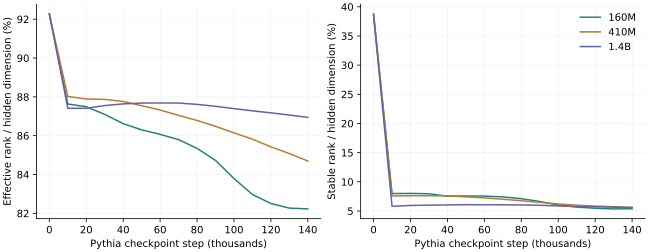
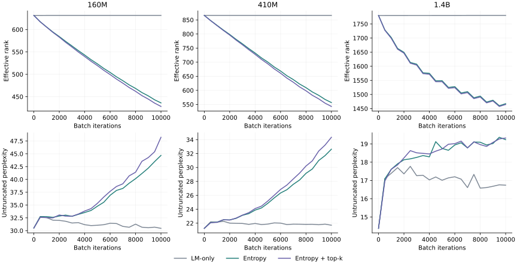
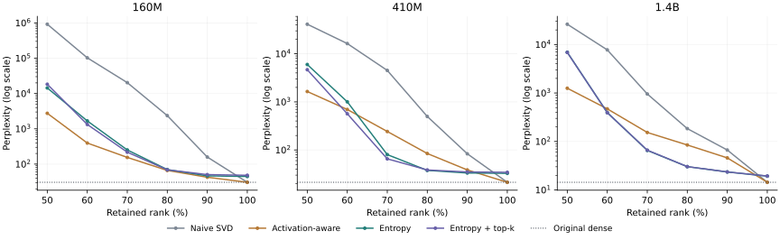

# Spectral Entropy for Low-Rank Language-Model Compression

[中文报告](README_zh.md) · [Archived data](results/) · [Truncation table](docs/truncation.csv)

## Abstract

This study examines whether concentrating the singular-value spectrum of pretrained language-model weights improves their tolerance to subsequent low-rank truncation. Across Pythia-160M, 410M, and 1.4B, entropy-regularized adaptation reduces mean effective rank by approximately 18–36%. At 60% retained rank, subsequent naive SVD produces 16–61× lower perplexity than naive SVD applied to the original model. These gains come with an increase in untruncated perplexity and do not establish uniform superiority over an activation-aware baseline. The central result is a measurable trade-off between spectral concentration, original-model quality, and truncation robustness.

**The experiment measures numerical rank truncation. Its reconstructed dense weight tensors retain their original shapes; actual checkpoint-size, runtime-memory, and speed reductions are not measured here.**

## 1. Research question

A low stable rank can coexist with a broad singular-value tail. Consequently, energy concentration alone does not establish that a weight matrix can be truncated without a substantial language-modeling penalty. This project connects longitudinal spectral measurements with an intervention: minimize spectral entropy during adaptation, then measure the quality of rank-truncated weights.

The study contains three components: spectral tracking across public Pythia checkpoints; comparison of entropy and normalized nuclear-norm regularization; and cross-scale truncation with optional alignment to the original model's leading subspace. The figures and tables below present the measured cross-scale results.

## 2. Spectral metrics and objective

For singular values of a target weight matrix, the metrics are:

$$
p_i=\frac{\sigma_i}{\sum_j\sigma_j},\qquad
H(W)=-\sum_i p_i\log p_i,\qquad
\mathrm{ER}(W)=\exp H(W),\qquad
\mathrm{SR}(W)=\frac{\sum_i\sigma_i^2}{\sigma_1^2}.
$$

ER is the effective number of singular components under this normalized spectrum. SR emphasizes squared spectral energy. Neither quantity is a count of stored model parameters or a direct measure of task-relevant information.

The adaptation objective combines language modeling, a cached spectral-entropy surrogate, and an optional subspace penalty:

$$
\mathcal{L}=\mathcal{L}_{\mathrm{LM}}+
\gamma\sum_{\ell}H_{\mathrm{cached}}(W_\ell)
+\mu\sum_\ell\frac{\|W_\ell-P_\ell W_\ell Q_\ell\|_F^2}{\|W_\ell\|_F^2+\epsilon}.
$$

Here, $P_\ell=U_kU_k^\top$ and $Q_\ell=V_kV_k^\top$ project onto the original dense weight's leading left/right singular subspaces. Pure entropy uses $\mu=0$; the aligned variant uses $\mu=1$ with a 50% rank anchor. The entropy term itself does not specify a target retained rank, while the alignment term does.

Full SVD bases are refreshed periodically. Between refreshes, `diag(U_cached.T @ W @ V_cached)` approximates the spectrum; the implementation clamps this vector before normalization and logarithms. This is a differentiable surrogate in a cached basis, rather than an exact SVD of every updated weight. Gradient flow is handled by ordinary autograd through this projection.

The preliminary comparison uses the **normalized nuclear norm**, $\|W\|_*/\|W\|_F$. This scale-invariant ratio is not itself a convex function. The regularizer strengths are calibrated by initial gradient norms; this controls the initial regularization scale, not the entire subsequent optimization trajectory.

## 3. Experimental setup

The base models are [Pythia deduplicated checkpoints](https://github.com/EleutherAI/pythia), revision `step143000`. Target matrices are QKV, attention output, FFN up, and FFN down in each transformer block. Embeddings, normalization parameters, and biases are excluded from the spectral terms and truncation.

| Setting | Main entropy adaptation |
|---|---|
| Models | Pythia-160M / 410M / 1.4B |
| Corpus protocol | 50,000 C4 training texts; C4 validation perplexity |
| Sequence length | 512 tokens |
| Logged iteration budget | 10,000 batch iterations |
| Gradient accumulation | 4 iterations; 2,500 optimizer updates |
| Optimizer | AdamW, weight decay 0.01, gradient clipping 1.0 |
| Learning rate | 1e-5 / 1e-5 / 5e-5 respectively |
| Entropy strength | γ = 10 |
| SVD basis refresh | Every 1,000 batch iterations |
| Optional alignment | μ = 1, original-model top-k fraction 0.5 |
| Precision | FP32 for 160M/410M; BF16 for 1.4B |
| Evaluation interval | Every 500 batch iterations |

The saved loops accumulate unscaled losses over four batches. Evaluation consumes at most 40 batches, with batch size 2 for 160M/410M and 1 for 1.4B. Comparisons within a model scale therefore share its evaluation protocol; absolute scores across scales do not use identical numbers of evaluated sequences.

The preliminary regularizer comparison uses 160M, 2,000 batch iterations, a 200-iteration SVD refresh, and an entropy calibration anchor of γ = 30.

## 4. Spectral evolution in the original models



The longitudinal archive contains 15 checkpoints from step 0 through step 140,000. The final pretrained models used for intervention are separately loaded at step 143,000. Values below average the four target matrix types across layers.

| Model | ER: initial → last recorded | SR: initial → last recorded | SR reduction |
|---|---|---|---|
| 160M | 708.6 → 631.5 | 297.9 → 41.3 | 86.1% |
| 410M | 944.8 → 867.3 | 396.6 → 57.4 | 85.5% |
| 1.4B | 1889.8 → 1780.6 | 790.2 → 114.5 | 85.5% |


Stable rank falls much more sharply than effective rank. This establishes a divergence between two spectral summaries; it does not by itself prove that the remaining tail can be discarded safely.

## 5. Adaptation changes both rank and quality

| Model | Original PPL | LM-only PPL | Entropy PPL | Entropy + top-k PPL | ER: original → entropy | ER reduction |
|---|---|---|---|---|---|---|
| 160M | 30.51 | 30.45 | 44.68 | 48.22 | 631.5 → 436.1 | 30.9% |
| 410M | 21.26 | 21.71 | 32.63 | 34.34 | 866.0 → 556.6 | 35.7% |
| 1.4B | 14.38 | 16.74 | 19.23 | 19.32 | 1779.9 → 1467.3 | 17.6% |




Entropy adaptation concentrates the spectrum, but also raises perplexity before any truncation. For 1.4B, perplexity rises from 14.38 to 19.23, while its LM-only adaptation baseline ends at 16.74. A lower ER therefore should not be interpreted as an unconditional improvement in the original model.

The 160M regularizer comparison gives:

| Regularizer | Final PPL | Final ER | Final SR |
|---|---|---|---|
| baseline | 31.84 | 631.6 | 41.5 |
| entropy | 33.65 | 569.5 | 37.5 |
| nuclear | 34.61 | 564.9 | 32.4 |


Entropy provides slightly lower perplexity at slightly higher ER than the calibrated normalized nuclear-norm variant. This is a trade-off observed at one calibration setting, rather than a matched-ER dominance result.

## 6. Truncation robustness



All rows below use **60% retained rank**, $k=\lfloor0.6d\rfloor$, applied to the target matrices. Lower PPL is better. The final column compares pure entropy + SVD with original-model naive SVD.

| Model | Naive SVD PPL | Activation-aware PPL | Entropy + SVD PPL | Entropy + top-k + SVD PPL | Naive / entropy |
|---|---|---|---|---|---|
| 160M | 102,634.91 | 395.35 | 1,673.39 | 1,328.83 | 61.33× |
| 410M | 16,314.18 | 694.79 | 1,003.23 | 565.92 | 16.26× |
| 1.4B | 7,750.62 | 470.31 | 394.33 | 391.89 | 19.66× |


Relative gains over naive truncation are large, but absolute degradation can remain substantial: 1.4B reaches PPL 394.33 at this budget, compared with 19.23 before truncation. At 60% rank, the activation-aware baseline is stronger for 160M and 410M, while entropy is stronger for 1.4B. At 80% rank, entropy reaches 37.56 versus 84.37 for activation-aware truncation on 410M, and 30.16 versus 84.52 on 1.4B. The ordering depends on both model scale and rank budget.

The activation-aware baseline is this repository's implementation: centered activation covariance, whitening, SVD, and de-whitening. It does not include the full sequential parameter-update procedure of SVD-LLM, so these numbers should not be read as official SVD-LLM results.

### Downstream accuracy at 70% rank

| Model | Variant | HellaSwag (%) | ARC-Easy (%) | PIQA (%) |
|---|---|---|---|---|
| 160M | Dense | 29.03 | 44.19 | 62.08 |
| 160M | Naive SVD, 70% | 25.80 | 27.61 | 54.30 |
| 160M | Entropy + SVD, 70% | 26.37 | 30.68 | 56.31 |
| 160M | Entropy + top-k + SVD, 70% | 26.53 | 31.52 | 56.75 |
| 410M | Dense | 34.50 | 51.47 | 67.25 |
| 410M | Naive SVD, 70% | 26.33 | 30.13 | 56.37 |
| 410M | Entropy + SVD, 70% | 27.90 | 36.28 | 59.14 |
| 410M | Entropy + top-k + SVD, 70% | 28.19 | 36.95 | 59.52 |
| 1.4B | Dense | 41.71 | 61.45 | 71.87 |
| 1.4B | Naive SVD, 70% | 26.69 | 36.36 | 58.00 |
| 1.4B | Entropy + SVD, 70% | 29.60 | 41.71 | 62.08 |
| 1.4B | Entropy + top-k + SVD, 70% | 29.60 | 41.96 | 61.48 |


These are the archived raw accuracies (`acc,none`), using zero-shot prompts. The entropy variants generally recover some of the naive-truncation loss, but the compressed variants remain below the original dense models. The source records also contain normalized accuracy and standard errors. No significance conclusion is drawn from small differences between regularizer variants.

## 7. Rank budget and deployment storage

The current truncation code reconstructs $U_k\Sigma_kV_k^\top$ and writes it into the original dense `Linear` weight. Actual storage therefore remains dense.

If a future implementation stores two factors instead, an $m\times n$ weight requires $k(m+n)$ values rather than $mn$. For a square layer at 60% rank, factorization requires approximately **1.2×** its original weight count. Across the four Pythia target matrix shapes, factoring every target at the same $k=0.6d$ would require approximately **80% of their original weight values**, before biases, embeddings, other parameters, or metadata. These are algebraic estimates, not measured model-file reductions.

Practical export should skip factorizations that increase storage and then measure the resulting model directly.

## 8. Interpretation and open questions

The records support a relationship between deliberate spectral concentration and improved tolerance to naive truncation. They also show a quality cost before truncation and a nonuniform comparison with activation-aware compression. The main missing comparison is truncation of the matched **10,000-iteration LM-only adapted** baseline: its training trajectory is archived, but an equivalent full truncation curve is not. This limits attribution of all observed improvement specifically to the entropy term.

Additional work would assess seed variability, the effect of cached-basis staleness, measured training overhead, and real factorized inference. The cross-scale differences alone do not establish a mechanism such as “spectral saturation.”

## 9. Code and data

```bash
git clone https://github.com/fumitoshi0524/spectral-entropy-llm.git
cd spectral-entropy-llm
python scripts/build_results.py
```

This rebuilds the report summary, CSV table, and result index from archived JSON, without downloading a model or running an evaluation. Figures and tables in this report present the results directly.

For new experiments, install `requirements.txt`, then use the explicit entropy entry point:

```bash
python pipeline.py --experiment train --scale 160m --variant entropy
python pipeline.py --experiment train --scale 160m --variant entropy-topk
python pipeline.py --experiment train --scale 160m --variant baseline
python pipeline.py --experiment truncate --scale 160m --checkpoint runs/metrics/160m/entropy/checkpoint
```

See [reproduction notes](docs/REPRODUCTION.md) for configuration provenance and historical loop semantics. The original adapted weights were not retained; the release contains their recorded results. New runs save checkpoints under `runs/` and leave the archive untouched.

| Path | Content |
|---|---|
| `src/` | Spectral metrics, cached-basis regularizers, training, dense truncation |
| `pipeline.py`, `configs/entropy.yaml` | Restored entropy experiment entry points and recipe |
| `experiments/regularizer_selection.py` | Preliminary calibrated regularizer comparison |
| `results/` | Archived numerical results |
| `scripts/` | Data extraction, report tables, and figure rendering |
| `legacy/cosine/` | Earlier cosine route, isolated from the entropy entry point |

## 10. Related work

- Roy and Vetterli, [The Effective Rank: A Measure of Effective Dimensionality](https://doi.org/10.5281/zenodo.40328), EUSIPCO 2007, defines the entropy-based effective rank used here.
- Biderman et al., [Pythia](https://proceedings.mlr.press/v202/biderman23a.html), ICML 2023, provides the base models and public training checkpoints.
- Zhao et al., [GaLore](https://proceedings.mlr.press/v235/zhao24s.html), ICML 2024, uses periodic low-rank gradient projection for training-memory efficiency. This project uses periodic **weight** SVD bases to approximate a regularizer; it does not implement GaLore's gradient projection or claim its memory benefits.
- Wang et al., [SVD-LLM](https://arxiv.org/abs/2403.07378), ICLR 2025, combines truncation-aware whitening with sequential low-rank parameter updates. It motivates the activation-aware comparison, subject to the implementation scope described above.
- Dolatabadi et al., [NuMuon](https://arxiv.org/abs/2603.03597), 2026, constrains Muon update directions to improve compressibility. Here, an entropy penalty is added during AdamW adaptation of pretrained dense models; no experimental comparison with NuMuon is claimed.
- Janson et al., [Stabilizing Native Low-Rank LLM Pretraining](https://arxiv.org/abs/2602.12429), ICML 2026, introduces Spectron for stabilizing native factorized training. Its update spectral-norm control addresses a different setting from entropy-based reshaping before post-hoc truncation.
